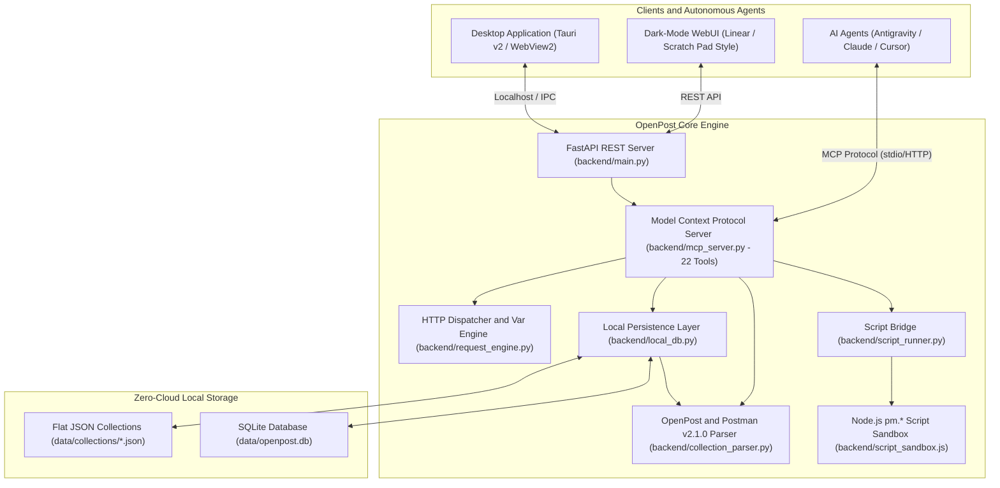

# OpenPost

<p align="center">
  <strong>The Clean-Room, Local-First Postman Scratch Pad Replacement.</strong><br>
  <em>Purely offline. Zero accounts. Zero telemetry. 100% Agent-Operable via Model Context Protocol (MCP).</em>
</p>

<p align="center">
  
  
  
  
  
  
</p>

---

## 🚀 Why OpenPost?

In late 2023, Postman deprecated and removed the beloved **offline Scratch Pad**, mandating cloud-synced accounts and forcing all API test traffic, collections, and sensitive credentials through external cloud servers.

**OpenPost** is a clean-room, open-source replacement designed from the ground up to restore the speed, privacy, and simplicity of local API testing:

* **Zero Cloud Mandate:** Stored 100% locally on your machine in human-readable flat JSON files and SQLite.
* **Decoupled Plain-Text Storage:** Collections persist using OpenPost's native schema (`https://openpost.dev/schema/v1/collection.json`) for seamless Git version control and line-by-line diffs.
* **100% Postman Collection v2.1.0 Interoperability:** Flawless import and round-trip export compatible with Postman schemas.
* **Agent-Operable via MCP:** Exposes **22 structured Model Context Protocol (MCP) tools** so AI agents (Antigravity, Claude, Cursor, Codex) can browse, author, execute, and verify APIs autonomously.
* **JavaScript Script Engine (`pm.*`):** Full pre-request and test script execution sandbox with Chai-compatible `pm.test()` and `pm.expect()` assertions.
* **Dual Desktop Options:** Ships with both a zero-wait native browser-app desktop launcher and a compiled **Tauri v2** standalone application with Windows MSI and NSIS installers.

---

## 🔬 Clean-Room Architecture & Legal Design

OpenPost was engineered from the ground up as a **strict clean-room implementation**, ensuring complete freedom from closed-source intellectual property, zero risk of copyright/DMCA infringement, and superior Git developer ergonomics.

### 1. Plain-Text Local Storage vs. Proprietary State Mirrored Databases
* **The DMCA Risk of Mirrored State:** Legacy clients and cloud platforms rely on proprietary, undocumented internal state storage—such as opaque Chromium LevelDB/IndexedDB binaries, internal Electron IPC envelope topics, or proprietary cloud-sync schemas. Replicating those internal structures creates severe DMCA takedown liability.
* **OpenPost's Native Plain-Text Schema:** OpenPost stores all API collections as transparent, human-readable plain-text JSON files on disk ([`data/collections/*.json`](data/collections/)) declaring OpenPost's native schema (`https://openpost.dev/schema/v1/collection.json`).
* **Git Version-Control Native:** Storing collections as plain-text files decouples API definitions from database engines. Teams can commit collections directly to Git, review line-by-line diffs in Pull Requests, branch freely, and resolve merges with standard Git tooling—without binary merge conflicts or database locking.
* **Separation of Concerns:** Ephemeral runtime state (execution history and environment variables) is persisted separately in a local SQLite database ([`data/openpost.db`](data/)), keeping collection definitions purely declarative.

### 2. Clean-Room Principles & Fair-Use Interoperability
* **Public Interchange Standard Only:** OpenPost implements import and round-trip export compatibility strictly against the publicly published **[Postman Collection Format v2.1.0](https://schema.postman.com/json/collection/v2.1.0/collection.json)** specification (released under the Apache-2.0 open schema license). It never relies on undocumented internal schemas.
* **Zero Lifted Code, Strings, or Assets:**
  * **No Raw Strings:** Production engines contain zero decompiled Electron IPC channel names, internal event bus strings, or proprietary header protocols.
  * **Original Visual Identity:** All icons, SVG vectors, and UI styles are 100% custom-created. The branding features an indigo/slate monogram with lightning glyphs, containing zero Postman trademarks, logos, or astronaut imagery.
  * **Zero Binary Contamination:** The repository contains no unpacked Electron ASAR archives, installer executables, or reverse-engineering memory dumps.
* **Independent Execution Engines:**
  * **HTTP Engine:** Built entirely from first principles on Python's `httpx` with an original URL path and dynamic variable interpolation engine.
  * **Script Sandbox:** Clean-room JavaScript runner implementing standard `pm.*` and Chai-like assertions from scratch in vanilla Node.js stdio.
  * **Desktop Integration:** Native Chromium/Edge `--app` launcher and standard Tauri v2 Rust wrapper with zero proprietary dependencies.

---

## 🏛 Architecture



---

## 🤖 Model Context Protocol (MCP) Integration

OpenPost transforms API testing into an entirely agent-operable workflow. Every UI capability is accessible as a structured tool:

### Complete MCP Tool Matrix (22 Tools)
| Domain | Available MCP Tools |
| :--- | :--- |
| **Collections** | `import_postman_collection`, `export_postman_collection`, `list_collections`, `get_collection`, `create_collection`, `delete_collection` |
| **Request Authoring** | `create_folder`, `save_request`, `delete_request` |
| **Execution & Runner** | `interpolate_preview`, `send_request`, `run_collection_request`, `run_collection` |
| **Scripting & Sandbox** | `execute_postman_script` (executes sandboxed JS with `pm.test` assertions) |
| **Environments** | `list_environments`, `get_environment`, `save_environment`, `set_environment_variable`, `delete_environment` |
| **History & Audit** | `list_request_history`, `get_history_entry`, `clear_request_history` |

### Connecting to Your AI Client

Add OpenPost to your `mcp_config.json` (Antigravity, Claude Desktop, Cursor, or Cline):

```json
{
  "mcpServers": {
    "openpost": {
      "command": "python",
      "args": ["-m", "backend.mcp_server"],
      "cwd": "/path/to/openpost",
      "env": {
        "PYTHONPATH": "/path/to/openpost"
      }
    }
  }
}
```

---

## 🧪 Pre-Request & Test Scripts (`pm.*` Sandbox)

OpenPost includes a Node.js-powered execution sandbox supporting authentic Postman scripts:

```javascript
// Pre-request Script:
pm.environment.set("request_id", "req_" + Date.now());

// Test Script (Chai-Compatible Assertions):
pm.test("Status code is 200", function () {
    pm.response.to.have.status(200);
});

pm.test("Response body matches schema", function () {
    var json = pm.response.json();
    pm.expect(json.status).to.equal("success");
    pm.expect(json.data.user.email).to.include("@example.com");
});

// Chaining Tokens into Environment for Downstream Requests:
pm.environment.set("auth_token", pm.response.json().token);
```

When running a collection, environment variables updated by `pm.environment.set()` automatically persist and chain into all subsequent requests in the run.

---

## 📦 Getting Started

### 1. Installation
Clone the repository and set up the Python environment:
```bash
git clone https://github.com/zshortbusz/openpost.git
cd openpost

python -m venv .venv
.\.venv\Scripts\activate

pip install -r requirements.txt
```

### 2. Launch Options

#### Option A: WebUI (Browser Mode)
```bash
uvicorn backend.main:app --port 8000 --reload
```
Open `http://127.0.0.1:8000` to access the dark-mode Scratch Pad interface.

#### Option B: Instant Desktop Launcher
```bash
python desktop/run_desktop.py
# Or: npm run desktop:launch
```
Spawns the backend and opens a clean, standalone desktop window in native app mode.

#### Option C: Tauri Standalone Desktop Build
```bash
# Development:
npm run desktop:dev

# Build Windows MSI and EXE Installers:
npm run desktop:build
```
Compiled installers are output to `src-tauri/target/release/bundle/msi/` and `nsis/`.

---

## 🧪 Running Automated Tests

OpenPost maintains a strict 100% test-passing invariant across schema ingest, interpolation, MCP tools, and desktop integration:

```bash
pytest -v
```

---

## 📄 License & Changelog

* See [CHANGELOG.md](CHANGELOG.md) for version history and recent fixes.
* OpenPost is released under the [MIT License](LICENSE).
* Postman is a registered trademark of Postman, Inc. OpenPost is an independent clean-room open-source project and is not affiliated with, endorsed by, or associated with Postman, Inc.
